# RAPPORT ICT COMPLET : scénarios fléchés de Rayle et structure complète de la partie visible

Branche `ict-complet`, fusionnée dans `main` à la fin (voir « Résultat final »). Date : 2026-11-27. Tout est gratuit, rien n'est déployé côté Worker. Le dossier `ICT-COMPLET/` n'est **pas** commité (`.gitignore`) ; les maquettes et les captures « avant » sont copiées dans `RAPPORT-ICT-COMPLET-captures/`. Les règles de l'ICT épuré sont gardées : petits carrés, rien jusqu'au bord, un prix = une ligne, Essentiel 8 objets, texte fermé par défaut.

## Ce que Justin demandait
1. Les petites flèches de scénario avaient disparu : les revoir, sur les rebonds possibles.
2. En Complet, les order blocks manquaient.
3. En Complet, la structure manquait quand on remonte dans le temps (pas de plus bas, pas de MSS ni de BOS dans la baisse).
+ le mode Volume, sursaturé de libellés longs répétés (7 fois « Zone de volume extrême vendeur · laissée par une bougie à fort volume »).

## Avant / maquette / maintenant
| « Avant » (M15, Complet, deux jours en arrière) | Maintenant (même vue, vraies bougies de l'or) |
|---|---|
| 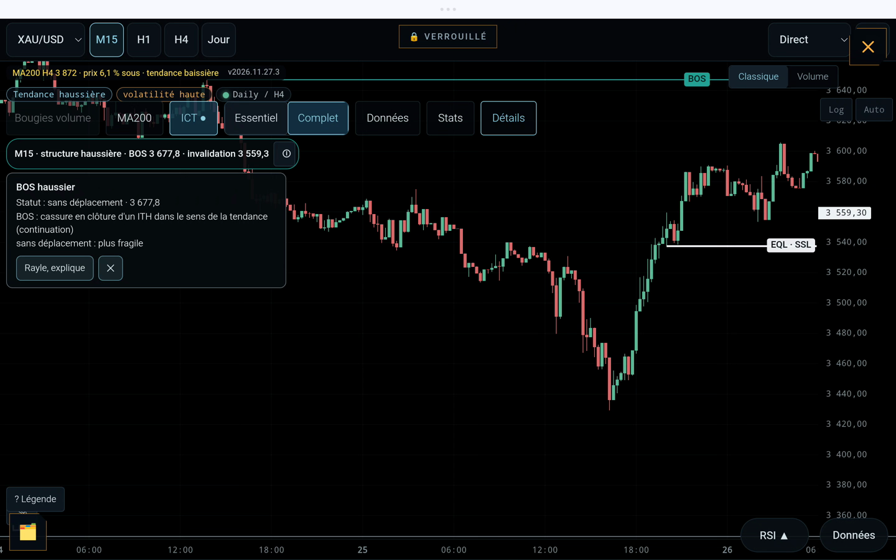 | 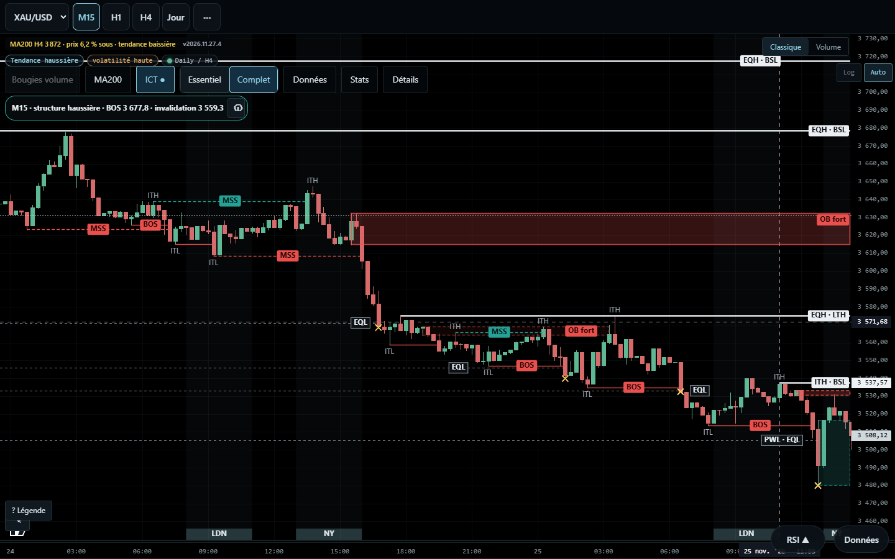 |

| Maquette Complet (A et B) | Maintenant, Complet (H1, tablette 1440 × 900) |
|---|---|
| 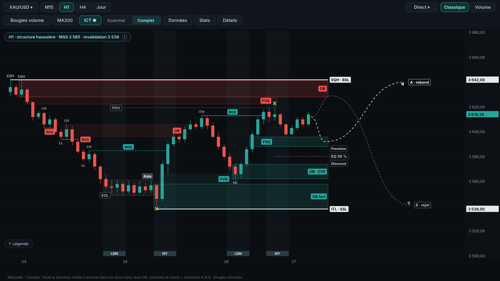 | 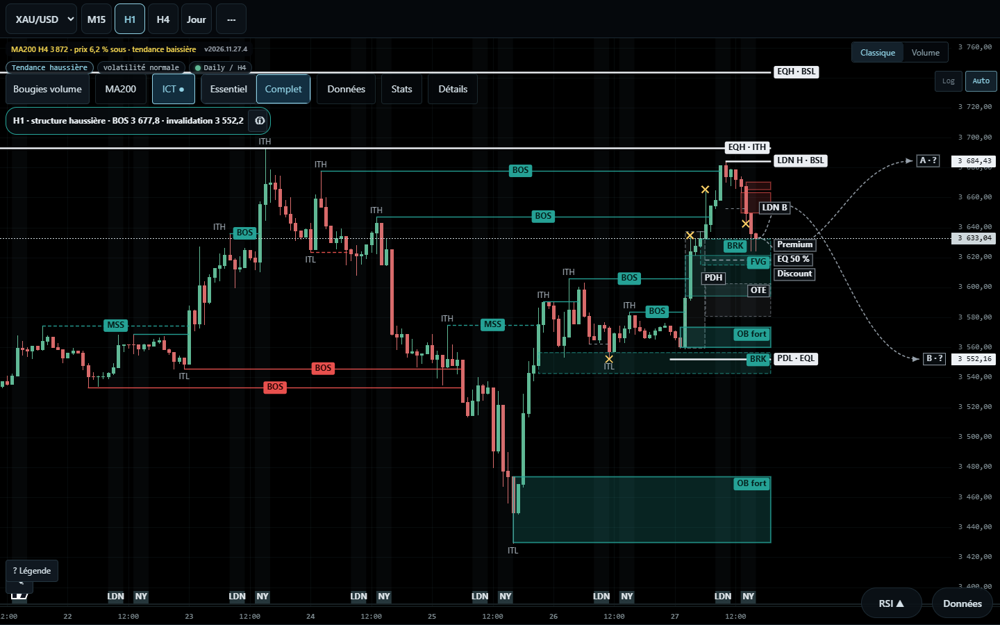 |

| Maquette Essentiel (scénario A) | Maintenant, Essentiel (H1) |
|---|---|
| 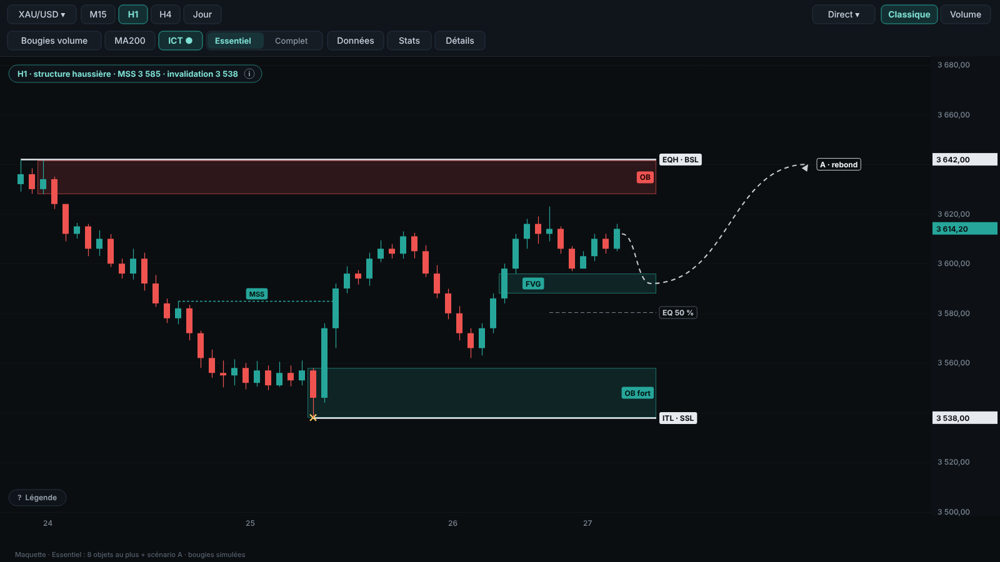 | 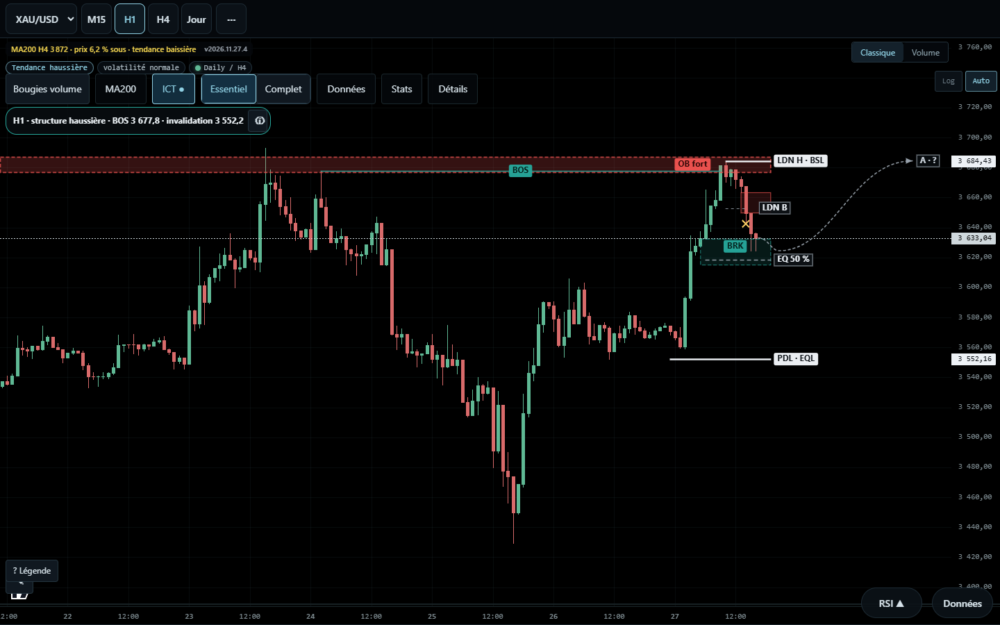 |

| Complet M15 (vue d'arrivée) | Complet H4 | Téléphone 384 px, H1, Complet (A seulement) |
|---|---|---|
| 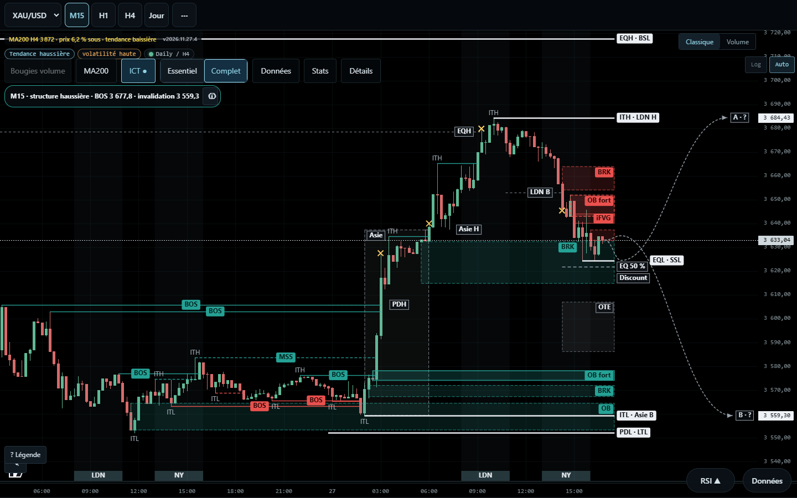 | 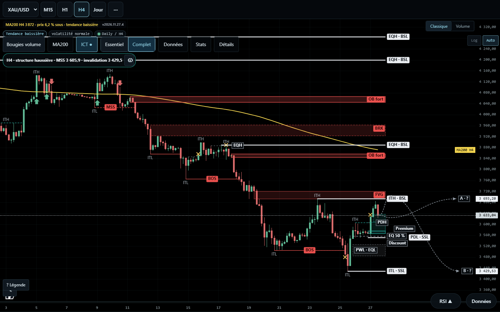 | 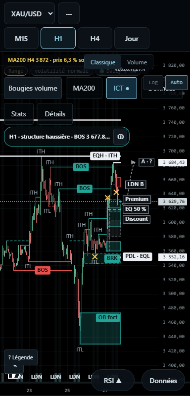 |

Essentiel M15 et H4, Essentiel téléphone : `reel-tab1440-{M15,H4}-essentiel.png`, `reel-tel384-H1-essentiel.png`. Bulle d'une flèche : `reel-tab1440-bulle.png`.

Les captures sont faites sur le **chemin réel** (`or.html` avec `integration.js`, sans `?pro=1`), avec les **vraies bougies de l'or** (relais Kraken et Binance réels). La lecture du moment étant **neutre** sur l'or, les flèches sont grises avec « ? » : c'est la règle voulue (« Si la lecture est neutre, montre quand même A et B, tous les deux en gris et de même épaisseur »). Le dessin d'un scénario qui penche (A blanc 2 px, B gris 1,6 px) est vérifié par les tests purs sur des séries qui penchent à l'achat et à la vente.

## 1. Scénarios fléchés A et B (`ict-scenarios.js`, `ict-dessin.js`)
- **Calcul pur** (`scenariosIct(an)`) à partir de la **même analyse** `ict-v2` que `lecture_ict` : deux scénarios au plus.
  - **A**, dans le sens de la lecture : le prix va vers la zone de réaction la plus proche du bon côté (FVG, OB, OB fort, breaker, à défaut l'OTE), y **rebondit** (ou, si la lecture est vendeuse, y est **rejeté**), puis part vers la liquidité externe visée (BSL ou SSL, la plus proche non prise, de préférence externe).
  - **B**, dans l'autre sens : le prix est **rejeté** par la zone opposée (ou y rebondit), puis part vers l'autre liquidité.
  - Lecture **neutre** : A (haussier) et B (baissier) quand même, **tous deux gris**, de même épaisseur, carrés `A · ?` et `B · ?`.
  - Un scénario a **toujours** une zone, une cible et une invalidation (« clôture sous … » / « au-dessus de … »). **Jamais** de flèche vers une liquidité déjà prise (testé en marquant la cible comme prise : une autre est choisie). Un scénario **invalidé disparaît** (testé avec un prix au-delà de l'invalidation). Il est recalculé à chaque nouvelle bougie.
- **Dessin** : une courbe en pointillé qui part de la dernière bougie, entre dans la zone, rebondit et finit par une **pointe de flèche** sur la liquidité visée ; **A en blanc 2 px** (pointillé 6-4), **B en gris 1,6 px** (pointillé 3-4, plus fin) ; un **petit carré au bout** de chaque flèche : `A · rebond`, `B · rejet` (ou `A · rejet` / `B · rebond` selon le sens). Le carré est placé par le même placeur que les autres carrés (jamais sur une bougie ni sur un autre carré) ; sur téléphone, sans place à droite de la pointe, il se cale à droite au-dessus ou au-dessous.
- **Essentiel : A seul. Complet : A et B. Téléphone : A seul.**
- **Marge à droite** (`graphique-or.js`) : avec l'ICT, la vue par défaut laisse **20 % de la largeur** vide à droite (PC, tablette), **25 %** sur téléphone ; l'ICT éteint, la marge d'avant (5 bougies) est **rendue**. Mesuré en Chrome : 20,6 % sur tablette, 25 % sur téléphone, 3,6 % une fois éteint. Correction au passage : la marge suit toujours l'état de l'ICT, même quand les bougies d'une nouvelle unité arrivent après lui (sans cela, M15 et H4 restaient à 3,6 %).
- **Toucher une flèche** (ou son carré) ouvre une bulle de **4 lignes** : « Zone de rebond : … », « Cible : … », « Invalidation : clôture … », « Une possibilité, pas une prévision. », puis le bouton « Rayle, explique » dessous.
- **Carte ⓘ** : A et B en deux lignes. **`lecture_ict`** porte aussi `scenarios` (zone, cible, invalidation, phrase).
- **Voix** : « Rayle, quels scénarios ? » (commande de type `ict` dans `commandes-or.js`) lit A et B pour l'unité affichée, termine par « C'est toi qui décides », sans jamais dire « achète » ni « vends ». (« Quels sont les scénarios » garde son sens d'avant : les scénarios de la stratégie de Rayle.)

## 2. Complet = toute la structure de la partie visible (`ict-complet.js`, `ict-objets.js`, `ict-or.js`)
- **Calcul sur toutes les bougies chargées** (`ict-v2.analyser` avec une portée illimitée, ~60 ms sur 1 500 bougies M15), **dessin de ce qui est à l'écran** : `objetsIct(an, { fenetre: { i0, i1 } })`. Quand on fait défiler ou qu'on zoome, le graphique prévient (`surPlage`, **anti-rebond de 150 ms**) et les objets sont recalculés pour la plage visible. Essentiel inchangé.
- **Cassures dans les deux sens** : chaque BOS et chaque MSS au niveau ITH / ITL (jamais sur chaque petit sommet), haussiers en vert, baissiers en rouge, MSS en pointillé, carré `BOS` ou `MSS`. Une cassure dont le niveau est né **avant** la plage visible n'est pas tracée (sinon un trait part du bord gauche : c'était le principal bruit en M15 défilé).
- **Order blocks** : chaque cassure a son OB (la dernière candidate de même sens dont la reversal candle clôture avant la cassure ; la checklist de formation d'`ict-v2` est déjà exigée) avec le carré `OB` ou `OB fort`, haussiers et baissiers. Un OB **rempli** est pâle, en pointillé, et s'arrête à la bougie qui l'a rempli ; un OB **cassé en clôture** devient `BRK` ; un OB dans l'OTE prend **un seul carré combiné** `OB · OTE`.
- **Sommets et creux** : HH, HL, LH, LL, ITH, ITL sur toute la partie visible, petit texte gris sans fond, **12 au plus** par écran (les ITH / ITL d'abord, le reste réparti régulièrement).
- **Plafond** : **20 zones et niveaux au plus par écran** ; les cassures, les sommets et les scénarios ne comptent pas. **Fusion** : Unicorn d'abord (le FVG et le breaker qui le composent disparaissent), puis deux zones de même sens qui se recouvrent à plus de 60 % n'en font qu'une (le nom de l'autre passe dans la bulle), puis `OB · OTE`.
- L'état des FVG, OB et breakers est calculé **à la dernière bougie visible** (`zonesA`), pas à la dernière bougie chargée : en remontant dans le temps, une zone encore fraîche à ce moment-là l'est à l'écran.
- Dans la plage historique (la dernière bougie n'est pas à l'écran), ni scénario, ni Fibonacci, ni range asiatique : ils décrivent le présent.

## 3. Mode Volume (`trader-pro/volume/noms.js`, `volume-ui.js`)
Le même traitement, sans rien changer d'autre : petits carrés `Vol. vendeur`, `Vol. acheteur`, `VAH`, `POC`, `VAL`, `HVN`, `LVN`, `Réaction` ; zones voisines du même type (à moins de 0,1 ATR) **fusionnées** ; **6 carrés au plus** par écran ; **jamais deux fois le même libellé** ; un carré ne quitte **jamais** son prix (il glisse vers la gauche, jamais en hauteur) et ne recouvre ni bougie ni autre carré ; légende **fermée** par défaut ; **toucher** un carré ouvre une bulle de 4 lignes au plus (nom complet, prix ou fourchette, nombre de zones fusionnées).

| « Avant » (H4, sept libellés longs empilés) | Maintenant (H4, vraies données) |
|---|---|
| 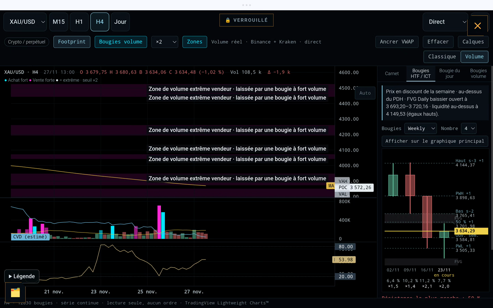 | 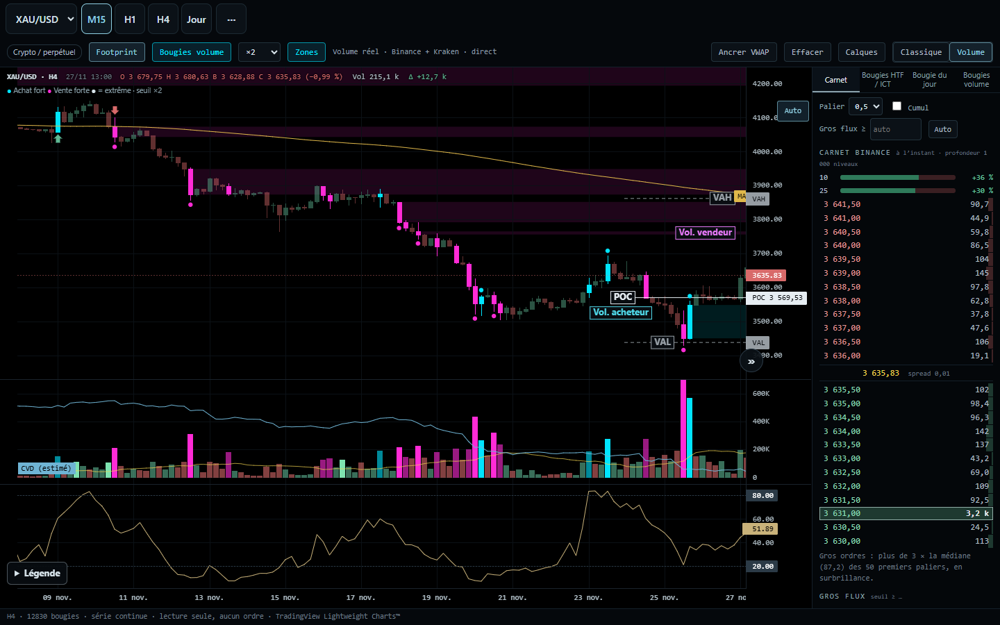 |

## Tests
- **Purs** : `trader-pro/tests/ict-complet-test.mjs` (**2 039**) : A et B ont toujours zone, cible, invalidation ; jamais vers une liquidité prise ; deux scénarios au plus ; neutre = gris avec « ? » ; invalidé = disparaît ; Complet : chaque BOS / MSS visible a sa couleur et son carré, chaque OB visible a son carré ; 20 zones et niveaux, 12 sommets au plus par écran ; objets recalculés quand la plage change ; fusions (Unicorn, 60 %, `OB · OTE`) ; flèches dans la marge à droite (PC, tablette, téléphone) ; Volume : 6 carrés au plus, aucun libellé répété, fusion à 0,1 ATR, carré toujours sur son prix. `ict-epure-test.mjs` (1 155) mis à jour (carrés `A · rebond`, 14 cassures et 12 sommets au plus, deux scénarios en Complet). Branché dans `npm test`.
- **Chrome** (chemin réel, vraies bougies) : `agent-trading/tests/ict-complet-chrome.mjs` (tab1440 : H1, M15, H4 ; tel384 : H1) : nombre de flèches par mode, carrés `A · …`, marge 20 % / 25 %, marge rendue ICT éteint, bulle de 4 lignes, carte ⓘ, voix par le vrai chemin `TableauOr.commande`, **M15 après un vrai glissé de la souris de deux jours en arrière** (objets recalculés, structure présente dans la baisse, plafonds), mode Volume (carrés, libellés, légende, bulle). Tous passent.
- `npm test` complet : vert. Version **2026.11.27.4** (`precache.json`, `sw.js`, `index.html`, `or.html`, `version.js`). `ict-v2.js` n'est pas modifié (sceau intact).

## Ce qui reste honnête
- **À valider sur la vraie tablette** (1440 × 900) : non testé hors émulation.
- Avec les vraies bougies de l'or du moment, la lecture est **neutre** : les flèches des captures sont donc grises (« ? »). Les flèches blanche et grise des scénarios qui penchent ne sont vérifiées que par les tests purs (dessin simulé), pas encore sur une capture réelle.
- Une cassure dont le niveau est né avant la plage visible n'est pas tracée (choix de sobriété) ; elle réapparaît en reculant la vue.
- Le Complet reste dense quand le marché est agité (beaucoup de structure visible) ; il est plafonné (20 zones, 12 sommets, 14 cassures) mais plus chargé que la maquette, qui est simulée.
- Piège de test : la réponse vocale de Rayle (`TableauOr.commande`) prend la main sur le graphique ; le test la lance en dernier.

## Résultat final
Fusionné dans `main` (commit `f1944ea5`) et poussé. Après fusion : `ict-complet-test` 2 039 / `ict-epure-test` 1 155 / `volume-noms-test` 44 verts, `npm test` complet vert (exit 0), Chrome `ict-complet-chrome` (tab1440, tel384) et `ict-epure-chrome` (tab1440) verts, version 2026.11.27.4.
