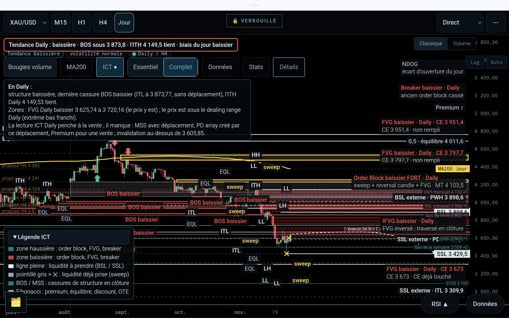
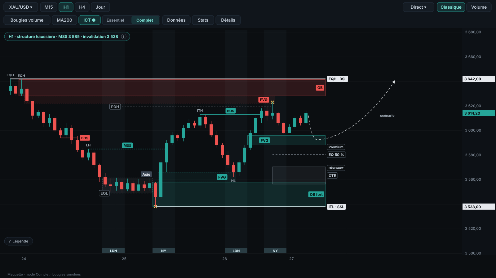
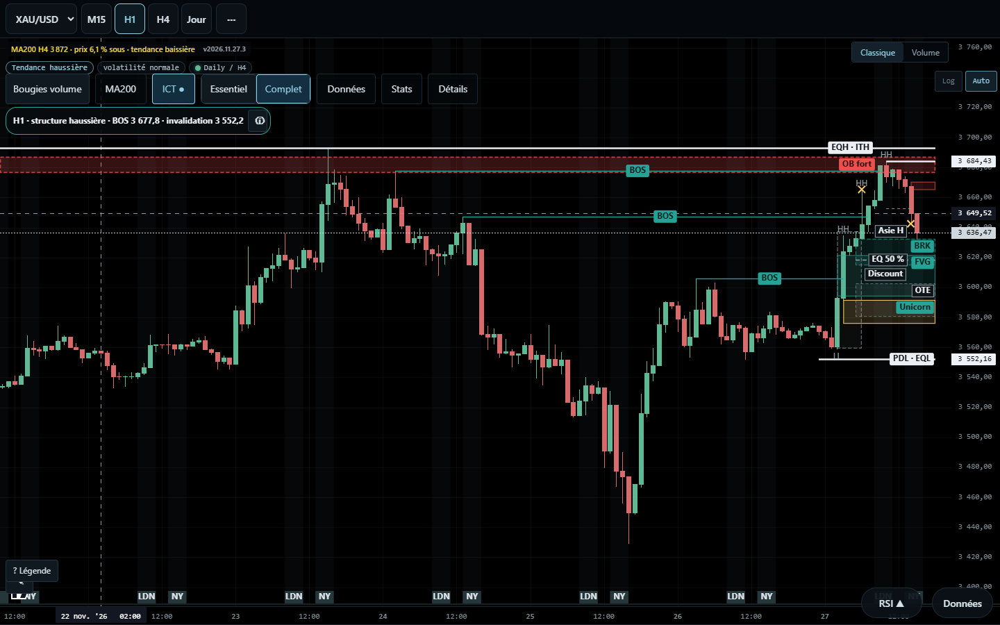
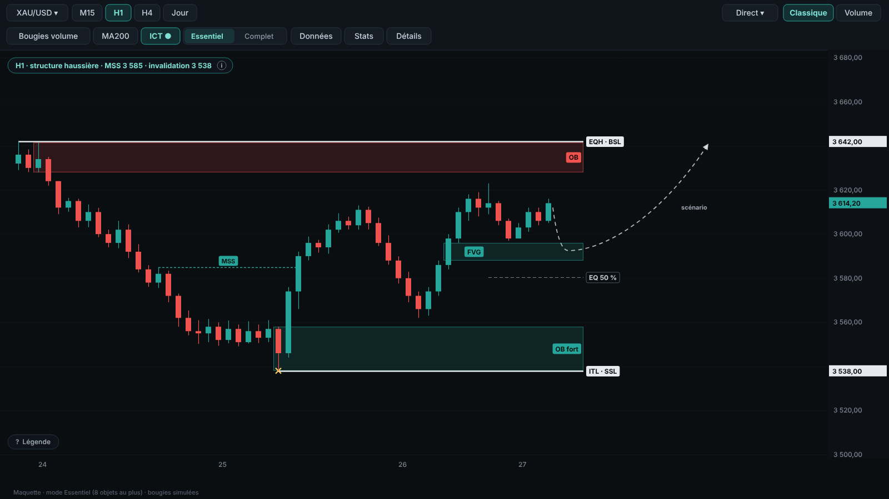
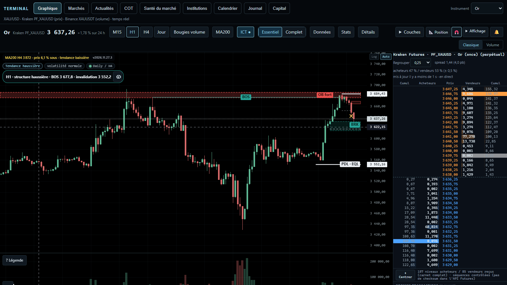
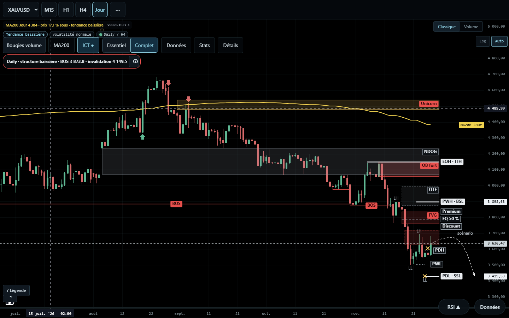

# RAPPORT ICT ÉPURÉ : garder tout le concept, le rendre lisible

Branche `ict-epure`, fusionnée dans `main` à la fin (voir « Résultat final »). Date : 2026-11-27. Tout est gratuit, rien n'est déployé côté Worker. Le dossier `ICT-EPURE/` n'est **pas** commité (`.gitignore`) ; les deux maquettes et la capture « avant » sont copiées dans `RAPPORT-ICT-EPURE-captures/`.

## Ce qui change, en une phrase
Chaque objet ICT est nommé par **un petit carré** (« FVG », « OB fort », « EQH · BSL »), les tracés s'arrêtent **3 bougies après la dernière**, un prix = **une** ligne, et tout le texte (carte, légende, bulle) est **fermé par défaut**.

## Avant / maquette / après (H1, Complet)
| « Avant » (tablette de Justin, Jour, Complet) | Maquette visée (H1, Complet) | Maintenant (tablette 1440 × 900, H1, Complet, vraies bougies de l'or) |
|---|---|---|
|  |  |  |

| Maquette Essentiel | Maintenant, Essentiel (PC 1600, H1) | Maintenant, Complet (tablette, Jour : la vue de la capture « avant ») |
|---|---|---|
|  |  |  |

Toutes les captures (vraies bougies de l'or, relais Kraken et Binance joignables) : `RAPPORT-ICT-EPURE-captures/reel-{pc1600-M15, pc1600-H1, pc1600-H4, pc1600-J, tab1440-J, tab1440-H1, tel390-H1}-{essentiel, complet}.png`.

Défauts de la capture « avant », un par un :
| Défaut | Maintenant |
|---|---|
| carte « En Daily » sur le haut du graphique | carte **fermée** ; elle s'ouvre avec ⓘ et se ferme en touchant ailleurs |
| légende ouverte sur le bas | **fermée** derrière « ? Légende » |
| colonne de libellés longs à droite | supprimée : des petits carrés dans la zone ou au bout de la ligne |
| six « BOS baissier » et des « sweep » partout | 3 cassures au plus (1 en Essentiel), « BOS » / « MSS » ; 2 sweeps (1 en Essentiel) en ✕ jaune sans texte |
| « BSL externe · PWH » + « BSL » pour le même niveau, niveaux Rayle superposés | **une seule ligne** (0,1 ATR) ; les autres couches de niveaux de Rayle sont cachées tant que l'ICT est actif |
| échelle jusqu'à 5 400 | l'ICT ne change **jamais** l'échelle (mesuré avec et sans ICT, voir tests) |
| bulles de statistiques au toucher | plus de bulle de statistiques des niveaux de Rayle quand l'ICT est actif ; une seule bulle ICT, au toucher |

## Ce qui a été fait

### Les petits carrés (`ict-carres.js`, `ict-dessin.js`, `ict-objets.js`)
- **Un carré plein par objet**, texte sombre en gras, **12 px sur PC et tablette, 11 px sur téléphone** : vert (haussier), rouge (baissier), blanc (liquidité à prendre), **contour gris** (prise, Fibonacci, sessions, gaps). **Une ligne, 14 caractères au plus** (`nomCarre`, testé). Vocabulaire : `OB`, `OB fort`, `FVG`, `iFVG`, `BRK`, `BPR`, `Unicorn`, `EQH`, `EQL`, `PDH`, `PDL`, `PWH`, `PWL`, `ITH`, `ITL` (avec le côté pour une liquidité visée : `EQH · BSL`, `ITL · SSL`, `PDL · SSL`), `MSS`, `BOS`, `Asie`, `LDN`, `NY`, `EQ 50 %`, `OTE`, `Premium`, `Discount`, `NWOG`, `NDOG`. Ni unité, ni prix, ni « haussier / baissier », ni seconde ligne : tout cela est dans la bulle.
- **Où il se met** : dans la zone, ou au bout de la ligne ; il **glisse le long de son objet** (candidats de la droite vers la gauche) pour trouver une place libre, **jamais vertical** (même `y` pour tous les candidats). Obstacles : les bougies (corps **et** mèches), les boutons Log / Auto, la zone du badge, les autres carrés. **Sans place libre : pas de carré**, l'objet garde sa couleur et son nom apparaît au toucher. `placerEtiquettes` (et son décalage vertical de 8 hauteurs) n'est plus utilisé par l'ICT ; il reste pour le mode Volume, qui ne change pas.
- **Longueur des tracés** : un objet ouvert s'arrête **3 bougies après la dernière** ; une zone remplie à la bougie qui l'a remplie (plus pâle, pointillé, Complet seulement, 50 dernières bougies) ; une liquidité prise à la bougie du sweep (1 px, gris, pointillé) avec un ✕ jaune (Complet ; le dernier sweep reste en Essentiel).
- **Fibonacci** : plus de grille. Essentiel : une ligne courte en pointillé `EQ 50 %`. Complet : `EQ 50 %`, un petit rectangle `OTE` (0,62 – 0,79) et deux carrés `Premium` / `Discount`.
- **Killzones** : une seule bande en bas, noms courts `LDN` / `NY`, en Complet, M15 et H1 seulement.
- **Épaisseurs** : liquidité externe (extrémités du dealing range, PDH / PDL, PWH / PWL, EQH / EQL) **2,4 px** trait plein blanc ; autres niveaux **1,4 px** ; liquidité prise **1 px** gris pointillé.
- **Combien d'objets** : **Essentiel 8 au plus** (zone ouverte la plus proche de chaque côté + OB fort, BSL et SSL externes, dernier MSS / BOS, `EQ 50 %`, dernier sweep) **plus le scénario** ; **Complet 20 au plus** (3 dernières cassures, 4 derniers sommets / creux en petit texte gris sans fond, 2 derniers sweeps, zones ouvertes et remplies récentes, range asiatique, bande de killzones). Le scénario n'est pas compté.
- **Aucun doublon** : deux niveaux à moins de 0,1 ATR sont **fusionnés** en une ligne avec un carré combiné (`PDH · EQH`, la BSL / SSL passe dans la bulle quand 14 caractères ne suffisent pas). L'équilibre qui tombe sur une ligne n'est pas tracé deux fois (son nom passe dans la bulle).
- **Pastilles de l'axe** : le **prix seulement**, en blanc, pour la BSL et la SSL visées (lignes de prix sans trait, `createPriceLine` : elles n'entrent jamais dans l'échelle). Le prix actuel garde sa pastille native.

### Moins de texte à l'écran (`ict-or.js`)
- **Badge** d'une seule ligne : « H1 · structure haussière · MSS 3 585,0 · invalidation 3 538,0 » + ⓘ, **sous** la rangée « Tendance … · volatilité … » et **sous** la barre d'outils (tablette, téléphone). Une place est réservée en haut du graphique (`reserverHaut`, la même avec ou sans ICT) : ni la barre d'outils ni le badge ne passent sur une bougie.
- **Carte « En H1 »** fermée par défaut ; ⓘ l'ouvre, un appui ailleurs la ferme. Elle porte des verdicts **nommés pareil partout** : « Structure H1 : haussière depuis le MSS à 3 585,0 ; l'ITL 3 538,0 tient. », « MA200 H1 : prix en dessous (… ) », « Lecture ICT : neutre, parce que … », « Scénario : … » (l'explication du scénario est ici). **Prix à une décimale.**
- **Légende** fermée par défaut, bouton « ? Légende ». Texte de la légende mis à jour (carrés, traits, ✕).
- **Bulles** : seulement au **toucher** d'un objet ou de son carré (jamais au survol), **une seule à la fois**, **4 lignes au plus** (nom, statut + prix exact, une ou deux raisons) ; « Rayle, explique » donne le reste. Fermée par un appui ailleurs. Les bulles de statistiques des niveaux de Rayle ne s'ouvrent plus quand l'ICT est actif.
- **Scénario** : flèche en pointillé et le seul mot « scénario ».

### Les autres couches de Rayle cachées quand l'ICT est actif (`graphique-or.js`, `integration.js`)
Niveaux proposés H4, VAH / VAL mensuels, bas de la semaine / du mois, chiffres ronds (`rayNiveaux`), zones de réaction (supports / résistances, liquidité, grosses zones lisibles, **zones de réaction historiques sur 10 ans**), boîtes de position, mouvements H1, boîtes et ligne de retournement : **non tracés**. La **MA200** reste (si son bouton est allumé), ainsi que les flèches et vos propres dessins. Si un de ces niveaux tombe sur un objet ICT (0,1 ATR), **son nom est ajouté à la bulle de l'objet ICT** (« Aussi : VAH mensuel … »), il n'est pas tracé deux fois.

### L'échelle de prix ne bouge pas
Les objets ICT n'entrent pas dans l'échelle (primitives de dessin, lignes de prix sans trait). La marge haute réservée et la marge de 18 bougies à droite (pour les carrés) ne dépendent pas de l'ICT : même jeu de bougies visibles, même échelle. Un objet hors de la partie visible n'est pas dessiné. **Mesuré dans Chrome** : prix lus à trois hauteurs du graphique identiques avant et après avoir allumé l'ICT, sur toutes les vues.

### Un vocabulaire cohérent (§ 9)
- Prix à **une décimale** dans le badge, la carte et la bulle (« 3 605,9 »).
- **Dealing range recalculé après chaque BOS ou MSS** (`ict-v2.js`, re-scellé) : un ITH / ITL déjà cassé en clôture est remplacé par l'extrême atteint depuis ; le prix reste donc **toujours dans son range** (testé sur les 16 jeux). La même règle interne / externe s'applique sur toutes les unités, et le texte correspond à ce qui est dessiné. Fini le « au-dessus du dealing range ».
- **Mêmes noms** entre le dessin et `lecture_ict` (une seule liste d'objets, `objetsIct`) : testé sur 16 jeux × 2 modes.

### Tablette et téléphone
Tablette 1440 × 900 (testée), 1024 et téléphone 390 : la barre d'outils ne passe ni sur le badge ni sur une bougie (mesuré avec les rectangles de la page et des bougies). Le mode Volume ne change pas.

## Tests
- **Purs** : `trader-pro/tests/ict-epure-test.mjs` — **1 155 vérifications** sur 16 jeux (M15 / H1 / H4 / Jour × 4 séries) × Essentiel / Complet × PC / 1440 / 390 px : chaque carré sur une ligne de ≤ 14 caractères et dans le vocabulaire, sans unité ni prix ni sens ; couleurs ; Essentiel ≤ 8, Complet ≤ 20 ; pas deux lignes à moins de 0,1 ATR (+ fusion forcée de deux niveaux à 0,04 ATR) ; aucun carré sur une bougie (corps et mèches), sur un autre carré, ni loin de son objet ; carré replié (non dessiné) quand tout est bloqué ; zone ouverte arrêtée 3 bougies après la dernière, zone remplie à sa bougie, liquidité prise au sweep avec ✕, épaisseurs 2,4 / 1,4 / 1 px ; texte 12 / 11 px ; badge d'une ligne ; carte aux verdicts nommés et prix à une décimale ; dealing range recalculé ; mêmes noms que `lecture_ict`. Remplace `ict-visuel-test.mjs` (dans `npm test`).
- **Chrome sur le chemin réel** (`or.html` + `integration.js`, sans `?pro=1`) : `agent-trading/tests/ict-epure-chrome.mjs`, **tab1440** (Jour, H1), **pc1600** (M15, H1, H4, Jour), tab1024 et **tel390** (H1), Essentiel et Complet : mêmes contrôles sur l'écran réel + échelle identique avec ICT allumé / éteint, carte et légende fermées par défaut, ⓘ et « ? Légende », un appui ailleurs ferme tout, aucune bulle au survol, une seule bulle de ≤ 4 lignes, couches de Rayle cachées (y compris avec « Détails » allumé), badge sous la rangée « Tendance » et hors de la barre d'outils, état conservé après rechargement, commandes vocales, aucune erreur de page. **Tout passe** sur les cinq vues, avec les bougies simulées (stables) **et** avec les vraies bougies de l'or.
- `npm test` : voir « Résultat final ». Sceau `ict-v2` re-posé ; `precache.json`, `sw.js`, `index.html`, `or.html`, `version.js` en **2026.11.27.3** (`ict-carres.js` ajouté au précache).

## Limites / à vérifier sur la vraie tablette
- **Non testé sur la vraie tablette** (1440 × 900, écran 2 880 × 1 800) ni sur un S23 Ultra : émulation Chrome (taille, toucher). À regarder : la lisibilité des carrés de 12 px à la main.
- **Très peu de place → pas de carré** : quand les bougies, une zone très étroite ou la marge de droite ne laissent aucun emplacement, le carré n'est pas dessiné (c'est voulu) ; l'objet est reconnaissable à sa couleur et son nom est dans la bulle. Cas le plus visible sur téléphone.
- **Sont abandonnés** par rapport à la version précédente (pas dans la liste de ce prompt) : lignes de projection −1 / −2, minuit New York, Silver Bullet, consolidations « Range », killzone « Clôture de Londres », ITH / ITL déjà cassés en texte, lignes CE / mean threshold à l'intérieur des zones (le CE et le MT sont dans la bulle). Les calculs existent toujours dans `ict-v2.js` ; seul l'affichage est allégé.
- **Sur téléphone**, le sélecteur « Classique | Volume » (flottant, d'avant) chevauche encore le bouton « Données » de la barre d'outils ; ce n'est ni le badge ni le graphique, et je ne l'ai pas touché.
- La carte ⓘ ne calcule la ligne « MA200 » que si 200 bougies de l'unité sont disponibles (moyenne simple des 200 clôtures), sinon la ligne est omise.
- « Rayle, explique » ne peut joindre Rayle que dans l'application ; hors de l'application il affiche la question à copier.

## Résultat final
Voir la dernière section ajoutée après la fusion (résultat de `npm test`, fusion et poussée).
