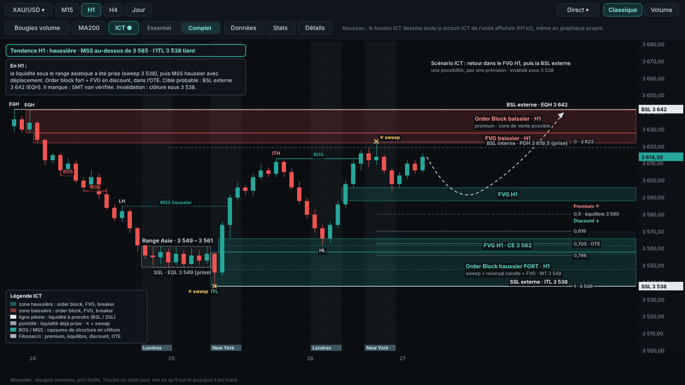
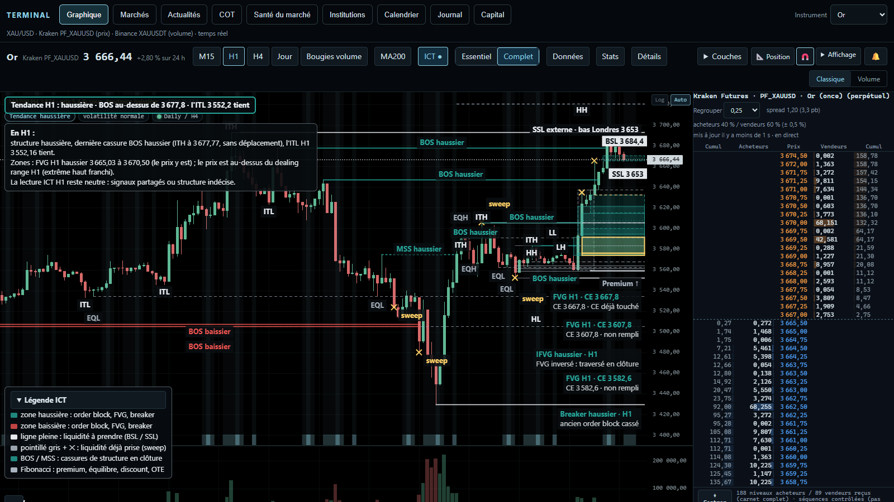
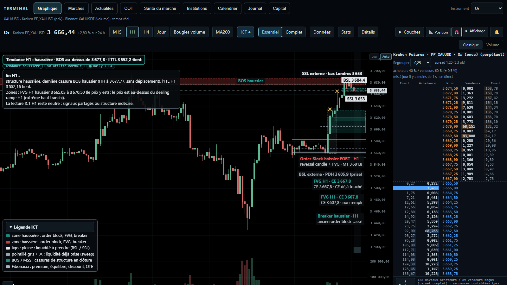

# RAPPORT ICT VISUEL : l'ICT bien visible et entièrement nommé sur le terminal classique

Branche `ict-visuel`, fusionnée dans `main` à la fin si tout passe (voir « Résultat final »). Date : 2026-11-27. Tout est gratuit, rien n'est déployé côté Worker. Les images de `ICT-VISUEL/` ne sont **pas** commitées (`.gitignore`) ; seule la maquette est copiée dans les captures de ce rapport.

## Pourquoi tu ne voyais rien (cause trouvée)
1. Le mode ICT d'hier n'existait que dans `terminal-pro.js` (sélecteur « Mode », chemin `?pro=1`), pas dans ton terminal `or.html` + `integration.js`.
2. Le « graphique propre » de `integration.js` (`COUCHES_PROPRES`) éteignait toutes les couches, ICT compris, y compris juste après un changement d'unité (réaffirmé à 2,5 s et 7 s).
3. Le dessin était trop discret (traits fins, 9 à 10 px, presque aucun nom).
4. Les tests d'hier passaient avec `?pro=1` : ce n'était pas ton chemin. **Les nouveaux tests Chrome tournent sur ton chemin réel** (voir plus bas).

## Ce qui a été fait

### Le bouton ICT (chemin réel : `or.html` + `integration.js`)
- Bouton **ICT** entre « MA200 » et « Données », même style ; à côté, quand il est actif, la bascule **Essentiel | Complet** (`trader-pro/terminal/integration.js`, `terminal-pro.css`). Sur téléphone la bascule passe dans le menu « ⋯ » (« ICT essentiel » / « ICT complet », `tactile-v1.js`) ; le bouton reste visible. Sur tablette (`tactile-v1`) il est dans la ligne de boutons du graphique. Il est masqué en mode Volume (qui n'affiche pas ce graphique).
- **L'ICT n'est plus jamais éteint par le graphique propre** : `COUCHES_PROPRES` garde les cinq couches ICT, et `appliquerDetails` rétablit l'ICT (`ict.reaffirmer()`) après avoir restauré les anciennes couches. `majRayle` ne touche que les couches `ray*`.
- État mémorisé (clé globale `rayle_ict_etat`, sans suffixe d'actif) : actif ou non, Essentiel ou Complet, carte et légende repliées ou non. Il revient après un rechargement, un changement d'unité (testé) ou d'actif.
- La MA200, ses flèches, le fond vert / rouge du classique ne bougent pas : l'ICT se dessine par-dessus (canvas du graphique + une couche d'interface).
- **Commandes vocales** : « Rayle, affiche l'ICT », « cache l'ICT », « ICT complet », « ICT essentiel » (`commandes-or.js`, `ict-or.js`).

### Le dessin (refait : `ict-dessin.js`, `ict-objets.js`, `ict-etiquettes.js`)
Sur le modèle de la maquette :
- **Zones rectangulaires nommées** (fond ≈ 0,16, bordure ≈ 0,75, nom en gras sur pastille sombre côté droit, détail sur une seconde ligne) : Order Block (FORT / simple, mean threshold, testé = pointillé, cassé → breaker), FVG (CE), IFVG, breaker, Unicorn (contour doré), BPR, NWOG / NDOG (H4 et Jour).
- **Lignes de liquidité nommées** « BSL / SSL interne / externe · EQH 3 642 », pleines et claires ; une liquidité prise passe en **gris pointillé « (prise) »** avec un **✕ jaune « sweep »** sur la mèche ; petites étiquettes « EQH » / « EQL » sur chaque sommet / creux égal ; PDH / PDL, PWH / PWL, haut et bas de l'Asie et de Londres (M15, H1), ITH / ITL, LTH / LTL.
- **Structure** : segments BOS / MSS du swing cassé à la bougie de cassure (MSS en pointillé, nom au milieu), étiquettes ITH / ITL, HH / HL / LH / LL (Complet).
- **Ranges** : range asiatique (M15, H1), consolidations ≥ 8 bougies dans 1,2 ATR (Complet).
- **Fibonacci premium / discount** du dealing range : 0 · 0,5 équilibre · 0,618 · 0,705 OTE · 0,786 · 1, bande OTE, « Premium ↑ » / « Discount ↓ » ; projections −1 et −2 de la jambe du dernier MSS (Complet).
- **Temps** (M15, H1) : bandes de killzones nommées en bas (Londres, New York, Clôture de Londres), minuit New York, Silver Bullet (Complet). Rien en H4 et en Jour.
- **Badge** « Tendance H1 : haussière · BOS au-dessus de 3 667 · l'ITL 3 662 tient », **carte de résumé repliable** (3 lignes, tirée de `resumeIct`), **scénario** en courbe pointillée blanche prix → PD array → liquidité visée (Complet, seulement si la lecture ne penche pas à « neutre », « une possibilité, pas une prévision · invalidé sous … », jamais une flèche d'achat ou de vente), **pastilles BSL / SSL** sur l'axe, **légende repliable** en bas à gauche.
- **Texte** : 13 px PC, 12 px tablette, 11 px téléphone, jamais moins, sur pastille sombre. **`placerEtiquettes`** (pur, testé) : décalage vertical, puis repli dans l'infobulle ; les dernières bougies, les boutons Log / Auto et les pastilles de l'axe sont des zones interdites. Marge vide à droite des bougies (`rightOffset`) tant que l'ICT est actif, rétablie ensuite.
- **Essentiel** (par défaut, 15 objets au plus) : badge, résumé, liquidité la plus proche et externe de chaque côté, PDH / PDL, les 2 PD arrays les plus proches de chaque côté, dernier BOS / MSS, Fibonacci, range asiatique et killzone en cours, légende. **Complet** : tout, sur les 150 dernières bougies.
- **Toucher un objet** : un clic ou un appui ouvre une bulle (nom, unité, prix, **pourquoi il est tracé**, statut) avec **« Rayle, explique »** : la question part à Rayle via `RayleBus` (`rayle:demande`, comme les autres boutons « Raylé explique… »), avec le nom de l'objet et l'unité affichée ; hors de l'application, la question est affichée à copier.

### Moteur (`ict-v2.js`, re-scellé) et outil
- Compléments purs : `porteeLiquidite` (interne / externe), `consolidations`, `listeCassures` (segments BOS / MSS), `etiquettesSwings` (HH / HL / LH / LL), `unicornBpr`, `gapsOuverture` (NWOG / NDOG), `projections` (−1 / −2), `fibonacci`.
- **Une seule liste d'objets** (`objetsIct`) pour le dessin **et** pour `lecture_ict` : mêmes noms, mêmes prix, même unité. `lecture_ict` renvoie maintenant `objets` (nom, prix, unité, statut, pourquoi ; les 24 plus proches), pour répondre à « c'est quoi la zone verte à 3 550 ? ». Consignes du cerveau et fiche du manuel mises à jour ; `resumeCarte` alimente la carte du terminal.

### Mode Volume : plus aucun rectangle ni ligne sans nom (`trader-pro/volume/noms.js`)
Chaque ligne (POC, VAH / VAL, niveaux de réaction, VWAP, POC nus, murs, gros ordres, PDH / PDL, équilibre, EQH / EQL, mes tracés…) et chaque zone (premium / discount, FVG / OB Daily, **zones cyan / magenta des bougies volume** : « Zone de volume extrême acheteur / vendeur », sessions Asie / Londres / New York) reçoit un **nom lisible** sur une pastille (mêmes tailles, mêmes règles de placement), et le mode a une **légende repliable** (POC / VAH / VAL, réaction, VWAP, zones cyan / magenta, premium / discount, FVG / OB, chaleur du carnet, gros ordres, sessions). Les étiquettes courtes de l'axe restent. Rien d'autre n'a changé dans le mode Volume. Les cellules du footprint et la chaleur du carnet (des textures, pas des objets) sont expliquées par la légende.

## Captures (vraies bougies de l'or : relais Kraken et Binance joignables)
Maquette à gauche, rendu réel à droite (H1, PC 1600 px). Les prix diffèrent forcément (maquette = bougies simulées).

| Maquette voulue | Rendu réel — Complet | Rendu réel — Essentiel |
|---|---|---|
|  |  |  |

Autres : `reel-pc1600-{M15,H4,J}-{essentiel,complet}.png`, `reel-tab1024-H1-*.png`, `reel-tel390-H1-*.png`, et le mode Volume avec ses noms et sa légende : `reel-volume-pc1600.png` (dossier `RAPPORT-ICT-VISUEL-captures/`).

## Tests
- **Purs** : `trader-pro/tests/ict-visuel-test.mjs` (119 vérifications : chaque objet nommé, essentiel ≤ 15, `placerEtiquettes` sans chevauchement sur 8 jeux, noms identiques entre le dessin et `lecture_ict`, tailles 13 / 12 / 11 px, interne / externe, ranges, BOS / MSS, HH / HL / LH / LL, Unicorn, BPR, NWOG, projections, Fibonacci) ; `volume-noms-test.mjs` (44) ; `ict-v2-test.mjs` (95, sceau compris). Ajoutés à `npm test`.
- **Chrome sur ton chemin réel** (`or.html`, `integration.js`, **sans `?pro=1`**) : `agent-trading/tests/ict-visuel-chrome.mjs` en pc1600, tab1024 et tel390, M15 / H1 / H4 / Jour, Essentiel et Complet : bouton visible entre MA200 et Données, rien avant le clic, ICT dessiné en graphique propre, conservé quand on allume puis éteint « Détails », **après un rechargement** et après un changement d'unité, objets nommés, aucun élément d'une autre unité, bulle + « Rayle, explique », quatre commandes vocales, pas de défilement horizontal en 390 px, aucune erreur de page. **Tout passe** (trois vues). Les anciens `ict-chrome.mjs` (chemin `?pro=1`) et `ict-scenarios-chrome.mjs` passent aussi.
- `npm test` : voir « Résultat final ». Sceau `ict-v2` re-posé, `precache.json` / `sw.js` / `index.html` / `or.html` / `version.js` en **2026.11.27.2**, `verrou-v8.json` mis à jour après `images-chrome` et `banc-30-chrome` (qui passent). `cerveau-chrome` passe cette fois ; `pilotage-chrome` garde 2 échecs d'origine (le terminal ouvert depuis Rayle en H4, surlignage de la MA200), les mêmes que sur `main`.

## Limites
- Les bougies des tests automatiques sont **simulées** (série calée sur le prix réel) pour que les résultats soient stables ; les captures du rapport, elles, sont réelles. Avec de vraies bougies, la plage de prix du graphique est large et beaucoup de zones sont minces : lis les noms, pas la hauteur.
- Quand le prix a franchi l'extrême du dealing range (cas de la capture réelle), le Fibonacci est hors de l'écran et la lecture dit « au-dessus du dealing range » : c'est voulu, pas un oubli.
- Le mode **Complet** est dense sur un marché très agité (jusqu'à une centaine d'objets sur 150 bougies) : les étiquettes sans place sont repliées dans l'infobulle (un clic les nomme). L'Essentiel reste à 15 objets.
- **Sur téléphone**, la carte de résumé recouvre le haut du graphique (repliable d'un appui sur le badge) ; la légende y est repliée par défaut.
- « Rayle, explique » ne peut joindre Rayle que dans l'application ; hors de l'application il affiche la question à copier. Non testé : l'envoi réel à Gemini (clé du Worker).
- Le mode Volume : la marge droite des pastilles (40 px) est un réglage empirique pour éviter l'axe des prix ; les noms de zones cyan / magenta se répètent quand plusieurs zones sont empilées.
- Les **zones du footprint** (cellules prix × temps) et la **chaleur du carnet** ne sont pas nommées une à une (des centaines de cellules) : la légende les décrit.
- Pas testé sur un vrai S23 Ultra ni une vraie tablette : émulation 390, 1024 et 1600 px. Les M15 d'actifs autres que l'or reposent sur les mêmes sources qu'hier (voir `RAPPORT-ICT.md`).

## Résultat final
`npm test` : **EXIT 0, aucun échec** (avec `ict-visuel-test`, `volume-noms-test`, `ict-v2-test`). Chrome sur le chemin réel : `ict-visuel-chrome` pc1600, tab1024, tel390 : tout passe. Branche `ict-visuel` fusionnée dans `main` et poussée.
