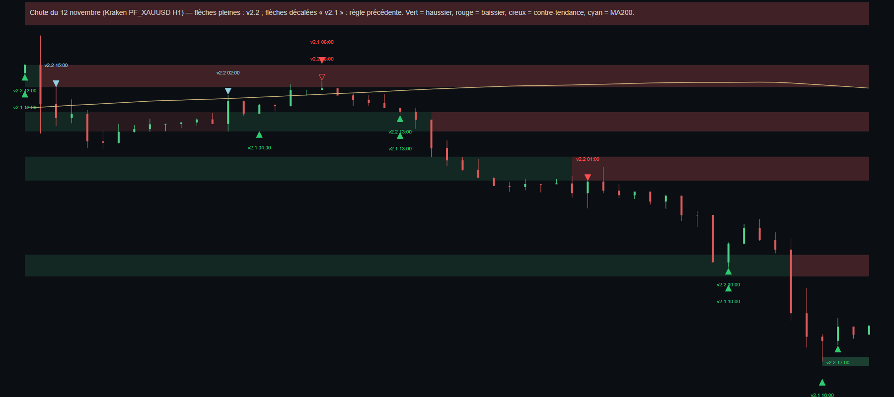

# Flèches v2.2 : rapport de rejeu

**Les règles de la v2.2 ont été ajustées après avoir vu ces exemples (chute en escalier du 12 novembre). Rien ici ne prouve une performance : « échoué » est une mesure descriptive faite après coup.**

Règle `fleches-lecture-v22` (par-dessus la v2.1, inchangée pour la MA200) : zone cassée (> 0,3 ATR) = plus de rebond dans l'ancien sens et un seul « retest de zone cassée » ; chute en escalier (zone cassée dans les 24 bougies + nouveau plus bas/haut) = rebond retenu tant qu'il n'y a ni base de 8 bougies (≤ 1,5 ATR), ni divergence RSI confirmée sur la zone, ni relance de 1 ATR ; flèche contre la MA200 = « contre-tendance » (plus petite et pâle). Couleurs : vert haussier, rouge baissier, cyan MA200.

## Chute du 12 novembre (série Kraken PF_XAUUSD H1, 28 sept. → 12 nov. 18 h UTC)

- Flèches d'achat sur zones pendant la chute (11 nov. 12 h → 12 nov. 19 h), **v2.1 : 3**, **v2.2 : 3**.
| clôture | sens | prix | nom | issue |
|---|---|---|---|---|
| 11-11 13:00 | achat | 4044 | Rebond haussier sur support | échoué (zone cassée dans les 12 bougies) |
| 11-12 10:00 | achat | 3946 | Rebond après relance (≥ 0,5 ATR) | échoué (zone cassée dans les 12 bougies) |
| 11-12 17:00 | achat | 3883 | Rebond après relance (≥ 0,5 ATR) | en cours |
- v2.1 pour comparaison : 11-11 13:00 à 4044 ; 11-12 10:00 à 3946 ; 11-12 16:00 à 3873.
- Toutes les flèches v2.2 de la période : 11-11 13:00 ↑ Rebond haussier sur support ; 11-12 01:00 ↓ Retest de zone cassée ; 11-12 10:00 ↑ Rebond après relance (≥ 0,5 ATR) ; 11-12 17:00 ↑ Rebond après relance (≥ 0,5 ATR).

## Historique or H1 2026 (Dukascopy, zones dessinées du dernier mois)
- Total : v2.1 = 93 ({"ma_cassure":55,"ma_retest":14,"rebond":24}), maximum sur 600 bougies 34 ; **v2.2 = 94 ({"ma_cassure":55,"ma_retest":14,"retest_zone":6,"rebond":19}), maximum sur 600 bougies 35** (> 25 : non masqué).
- Cas de contrôle : (a) rebond haussier ~3 870 le 2 nov. : OUI — 11-02 00:00 (Rebond haussier sur support (contre-tendance)) ; (b) cassure MA200 du 4 nov. : OUI ; (c) rebonds baissiers 4 131–4 156 : 6 (10-19 23:00, 10-20 06:00, 10-21 13:00, 10-21 21:00, 11-05 04:00, 11-10 02:00).
- Rebonds échoués (zone cassée dans les 12 bougies suivantes), phases **impulsives** (déplacement ≥ 4 ATR sur 24 bougies) : v2.1 = 1/7 décidées échouées (14 %), 8 flèches ; v2.2 = 1/6 décidées échouées (17 %), 7 flèches.
- Phases de **range** : v2.1 = 4/16 décidées échouées (25 %), 16 flèches ; v2.2 = 5/18 décidées échouées (28 %), 18 flèches.
- Limite : les zones dessinées ne couvrent que le dernier mois, donc la comparaison porte sur peu de flèches ; l'écart ne doit pas être lu comme une preuve.
