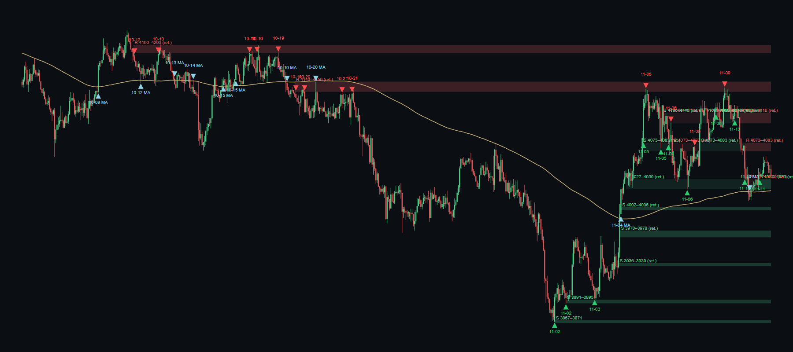

# Flèches v2 puis v2.1 : rapport de rejeu (or H1, 2026-01-01 → 11-11 12:00 UTC)

Règle `fleches-lecture-v2` (écrite avant le rejeu) : les flèches viennent de la MÊME liste de zones H1 que celle dessinée par le graphique (`zonesAffichage` : actives + traces), plus la MA200. Chaque flèche porte le `levelId` de la zone dessinée. Les « Rebond sur la MA » (continuation) sont supprimés de l'affichage.

## Cas demandés
- (a) rebond haussier sur la zone verte ~3 870 : OUI — 11-02 00:00 à 3898 (sr386906@1793574000000)
- (b) cassure de la MA200 sur la montée : OUI — 01-30 17:00 baissière ; 02-04 05:00 haussière ; 02-04 15:00 baissière ; 02-09 15:00 haussière ; 02-12 19:00 baissière (fausse cassure) ; 02-16 16:00 baissière ; 02-18 15:00 haussière (fausse cassure) ; 02-19 07:00 haussière (fausse cassure) ; 02-20 07:00 haussière ; 03-03 12:00 baissière (fausse cassure) ; 03-10 14:00 haussière ; 03-11 16:00 baissière ; 03-31 01:00 haussière ; 04-12 23:00 baissière (fausse cassure) ; 04-20 00:00 baissière (fausse cassure) ; 04-21 15:00 baissière ; 05-06 02:00 haussière ; 05-14 20:00 baissière ; 05-25 23:00 haussière (fausse cassure) ; 05-29 07:00 haussière ; 06-01 08:00 baissière ; 06-02 07:00 haussière ; 06-02 17:00 baissière ; 06-04 12:00 haussière (fausse cassure) ; 06-15 03:00 haussière ; 06-17 20:00 baissière (fausse cassure) ; 06-18 16:00 baissière ; 07-01 14:00 haussière (fausse cassure) ; 07-02 13:00 haussière ; 07-08 09:00 baissière ; 07-09 07:00 haussière ; 07-12 23:00 baissière ; 07-21 06:00 haussière ; 07-24 03:00 baissière (fausse cassure) ; 07-28 02:00 baissière ; 07-29 19:00 haussière (fausse cassure) ; 07-30 14:00 haussière ; 07-31 12:00 baissière ; 08-04 12:00 haussière ; 08-18 19:00 baissière ; 08-19 13:00 haussière ; 08-28 16:00 baissière ; 09-10 06:00 haussière (fausse cassure) ; 09-17 13:00 haussière ; 09-22 06:00 baissière ; 09-22 20:00 haussière ; 09-23 10:00 baissière ; 10-09 02:00 haussière ; 10-13 17:00 baissière (fausse cassure) ; 10-14 09:00 baissière ; 10-15 10:00 haussière (fausse cassure) ; 10-15 20:00 haussière ; 10-19 15:00 baissière ; 11-04 07:00 haussière ; 11-10 18:00 baissière (fausse cassure)
- (c) rebonds baissiers sur résistance 4 131–4 146 : OUI — 10-19 23:00 à 4136 ; 10-20 06:00 à 4119 ; 10-21 13:00 à 4130 ; 10-21 21:00 à 4141 ; 11-05 04:00 à 4140 ; 11-09 21:00 à 4142

## Compte avant / après (historique 2026)
- Avant (fleches-lecture-v1) : {"ma_rebond":22,"niv_confirme":45,"ma_retest":7,"ma_cassure":7,"niv_precoce":1}, total 82, maximum sur 600 bougies 12.
- v2 (zones brutes, MA200 sans hystérésis) : {"ma_cassure":58,"ma_retest":15,"rebond":27}, total 100, maximum sur 600 bougies 38.
- **Après (v2.1 : hystérésis MA200 + zones d'au moins 0,3 ATR fusionnées)** : {"ma_cassure":55,"ma_retest":14,"rebond":24}, total 93, maximum sur 600 bougies H1 : **34** ; sur les 600 dernières : 34 — **dépasse 25** (non masqué).
- Cohérence : 22 zones dessinées ; flèches sans niveau dessiné : 0.

## Liste des flèches (heure UTC de clôture)
| clôture | type | sens | prix | zone | issue | fav/adv 6 b. (ATR) |
|---|---|---|---|---|---|---|
| 01-30 17:00 | ma_cassure | baissier | 4984.5 |  | tient | 3.25 / 0.01 |
| 02-04 05:00 | ma_cassure | haussier | 5080.2 |  | tient | 0.2 / 0.68 |
| 02-04 15:00 | ma_cassure | baissier | 4984.4 |  | tient | 2.92 / 0.48 |
| 02-09 15:00 | ma_cassure | haussier | 5037.9 |  | tient | 1.33 / 0.4 |
| 02-10 00:00 | ma_retest | haussier | 5031.2 |  | confirmé | 0.68 / 0.64 |
| 02-12 19:00 | ma_cassure | baissier | 4935.2 |  | fausse cassure | 1.28 / 1.39 |
| 02-16 16:00 | ma_cassure | baissier | 4979.4 |  | tient | 2.11 / 0.94 |
| 02-17 01:00 | ma_retest | baissier | 4935.3 |  | confirmé | 3.58 / 1.62 |
| 02-18 15:00 | ma_cassure | haussier | 4991.6 |  | fausse cassure | 0.83 / 0.82 |
| 02-19 07:00 | ma_cassure | haussier | 5018 |  | fausse cassure | 0.22 / 2.19 |
| 02-20 07:00 | ma_cassure | haussier | 5020.3 |  | tient | 1.19 / 0.85 |
| 02-20 16:00 | ma_retest | haussier | 5042.3 |  | confirmé | 2.72 / 0.16 |
| 03-03 12:00 | ma_cassure | baissier | 5144.3 |  | fausse cassure | 3.09 / 1.71 |
| 03-04 03:00 | ma_retest | baissier | 5156.1 |  | confirmé | 0.7 / 0.49 |
| 03-10 14:00 | ma_cassure | haussier | 5204.9 |  | tient | 1.28 / 1.7 |
| 03-11 16:00 | ma_cassure | baissier | 5166.1 |  | tient | 1.63 / 0.76 |
| 03-11 23:00 | ma_retest | baissier | 5138.5 |  | confirmé | 0.59 / 1.62 |
| 03-31 01:00 | ma_cassure | haussier | 4547.5 |  | tient | 2.21 / 0.48 |
| 04-12 23:00 | ma_cassure | baissier | 4658.4 |  | fausse cassure | 0.55 / 2.65 |
| 04-20 00:00 | ma_cassure | baissier | 4754.9 |  | fausse cassure | 0.43 / 2.4 |
| 04-21 15:00 | ma_cassure | baissier | 4738.9 |  | tient | 3.33 / 0.87 |
| 05-06 02:00 | ma_cassure | haussier | 4625.9 |  | tient | 3.07 / 0.04 |
| 05-14 20:00 | ma_cassure | baissier | 4653.8 |  | tient | 2.64 / 0.64 |
| 05-25 23:00 | ma_cassure | haussier | 4574.6 |  | fausse cassure | 0.45 / 4.14 |
| 05-29 07:00 | ma_cassure | haussier | 4523.5 |  | tient | 1.15 / 0.81 |
| 06-01 08:00 | ma_cassure | baissier | 4502.9 |  | tient | 3.2 / 0.58 |
| 06-02 07:00 | ma_cassure | haussier | 4535.5 |  | tient | 0.35 / 1.3 |
| 06-02 17:00 | ma_cassure | baissier | 4491.7 |  | tient | 1.88 / 0.07 |
| 06-04 12:00 | ma_cassure | haussier | 4511.2 |  | fausse cassure | 0.21 / 2.88 |
| 06-15 03:00 | ma_cassure | haussier | 4329.4 |  | tient | 0.59 / 1.07 |
| 06-17 20:00 | ma_cassure | baissier | 4235.6 |  | fausse cassure | 0.03 / 3.57 |
| 06-18 16:00 | ma_cassure | baissier | 4226.4 |  | tient | 1.06 / 0.29 |
| 07-01 14:00 | ma_cassure | haussier | 4089.1 |  | fausse cassure | 1.16 / 2.41 |
| 07-02 13:00 | ma_cassure | haussier | 4117.3 |  | tient | 1.22 / 0.8 |
| 07-08 09:00 | ma_cassure | baissier | 4056.4 |  | tient | 1.16 / 1.51 |
| 07-09 07:00 | ma_cassure | haussier | 4107.6 |  | tient | 0.79 / 0.75 |
| 07-10 14:00 | ma_retest | haussier | 4099.7 |  | confirmé | 1.13 / 1.97 |
| 07-12 23:00 | ma_cassure | baissier | 4075.3 |  | tient | 1.51 / 0.92 |
| 07-14 13:00 | ma_retest | baissier | 4075.9 |  | confirmé | 1.78 / 1.32 |
| 07-21 06:00 | ma_cassure | haussier | 4061.1 |  | tient | 1.51 / 0.46 |
| 07-21 14:00 | ma_retest | haussier | 4052.8 |  | confirmé | 2.39 / 0.1 |
| 07-24 03:00 | ma_cassure | baissier | 4024.3 |  | fausse cassure | 0.2 / 2.59 |
| 07-28 02:00 | ma_cassure | baissier | 4044.9 |  | tient | 0.8 / 0.57 |
| 07-28 09:00 | ma_retest | baissier | 4045.3 |  | confirmé | 2.88 / 0.04 |
| 07-29 19:00 | ma_cassure | haussier | 4106.4 |  | fausse cassure | 0.52 / 3.45 |
| 07-30 14:00 | ma_cassure | haussier | 4112.1 |  | tient | 0.36 / 1.31 |
| 07-31 12:00 | ma_cassure | baissier | 4053.4 |  | tient | 2.21 / 0.39 |
| 08-02 23:00 | ma_retest | baissier | 4059.4 |  | confirmé | 0.73 / 1.17 |
| 08-04 12:00 | ma_cassure | haussier | 4074.8 |  | tient | 2.22 / 0.99 |
| 08-18 19:00 | ma_cassure | baissier | 4354.1 |  | tient | 1.92 / 0.28 |
| 08-19 12:00 | ma_retest | baissier | 4364.3 |  | échoué | 0.18 / 9.54 |
| 08-19 13:00 | ma_cassure | haussier | 4438.5 |  | tient | 3.21 / 0.78 |
| 08-28 16:00 | ma_cassure | baissier | 4524.1 |  | tient | 3.59 / 0.2 |
| 09-10 06:00 | ma_cassure | haussier | 4430.8 |  | fausse cassure | 0.26 / 3.39 |
| 09-17 13:00 | ma_cassure | haussier | 4373 |  | tient | 0.29 / 1.06 |
| 09-22 06:00 | ma_cassure | baissier | 4323.4 |  | tient | 1.91 / 0.85 |
| 09-22 20:00 | ma_cassure | haussier | 4363.7 |  | tient | 0.3 / 1.66 |
| 09-23 04:00 | ma_retest | haussier | 4342.4 |  | échoué | 0.29 / 2.15 |
| 09-23 10:00 | ma_cassure | baissier | 4314 |  | tient | 2.57 / 0.35 |
| 10-09 02:00 | ma_cassure | haussier | 4175.1 |  | tient | 2.14 / 0.37 |
| 10-12 08:00 | rebond | baissier | 4180.4 | 4189.8–4199.5 | confirmé | 2.07 / 0.07 |
| 10-12 13:00 | ma_retest | haussier | 4165.1 |  | confirmé | 0.84 / 0.53 |
| 10-13 04:00 | rebond | baissier | 4188.3 | 4189.8–4199.5 | confirmé | 0.65 / 1.01 |
| 10-13 17:00 | ma_cassure | baissier | 4152.6 |  | fausse cassure | 0.51 / 1.22 |
| 10-14 09:00 | ma_cassure | baissier | 4143 |  | tient | 5.24 / 1.04 |
| 10-15 10:00 | ma_cassure | haussier | 4156.8 |  | fausse cassure | 0.81 / 1.87 |
| 10-15 20:00 | ma_cassure | haussier | 4175.5 |  | tient | 0.29 / 1.97 |
| 10-16 08:00 | rebond | baissier | 4186.9 | 4189.8–4199.5 | confirmé | 2.34 / 0.37 |
| 10-16 14:00 | rebond | baissier | 4184.8 | 4189.8–4199.5 | confirmé | 1.92 / 0.92 |
| 10-19 08:00 | rebond | baissier | 4172.7 | 4189.8–4199.5 | confirmé | 2.08 / 0.47 |
| 10-19 15:00 | ma_cassure | baissier | 4145.5 |  | tient | 0.65 / 0.29 |
| 10-19 23:00 | rebond | baissier | 4136.1 | 4143.5–4155.6 | confirmé | 1.86 / 1 |
| 10-20 06:00 | rebond | baissier | 4119.4 | 4143.5–4155.6 | confirmé | 0.68 / 1.46 |
| 10-20 15:00 | ma_retest | baissier | 4142.9 |  | confirmé | 1.77 / 0.09 |
| 10-21 13:00 | rebond | baissier | 4129.5 | 4143.5–4155.6 | confirmé | 1.32 / 0.92 |
| 10-21 21:00 | rebond | baissier | 4140.8 | 4143.5–4155.6 | confirmé | 3.52 / 0.34 |
| 11-02 00:00 | rebond | haussier | 3898.1 | 3867.4–3870.7 | confirmé | 1.12 / 0.33 |
| 11-02 09:00 | rebond | haussier | 3897.4 | 3890.9–3895.3 | confirmé | 4.06 / 0.21 |
| 11-03 09:00 | rebond | haussier | 3896.8 | 3890.9–3895.3 | confirmé | 5.11 / 0.1 |
| 11-04 07:00 | ma_cassure | haussier | 4027 |  | tient | 1.14 / 0.58 |
| 11-05 02:00 | rebond | haussier | 4124.5 | 4072.5–4082.7 | confirmé | 1.11 / 0.79 |
| 11-05 04:00 | rebond | baissier | 4140.1 | 4143.5–4155.6 | confirmé | 1.58 / 0.26 |
| 11-05 16:00 | rebond | haussier | 4084.3 | 4072.5–4082.7 | confirmé | 2.05 / 0.15 |
| 11-05 22:00 | rebond | haussier | 4087.3 | 4072.5–4082.7 | confirmé | 0.89 / 2.31 |
| 11-06 01:00 | rebond | baissier | 4091.8 | 4105.9–4118.4 | confirmé | 2.53 / 0.24 |
| 11-06 14:00 | rebond | haussier | 4044.4 | 4027.2–4039.2 | confirmé | 1.7 / 0.73 |
| 11-06 20:00 | rebond | baissier | 4063.3 | 4072.5–4082.7 | échoué | 0.49 / 3.74 |
| 11-09 14:00 | rebond | haussier | 4124.8 | 4105.9–4118.4 | confirmé | 0.87 / 1.49 |
| 11-09 21:00 | rebond | baissier | 4141.6 | 4143.5–4155.6 | confirmé | 1.96 / 0.28 |
| 11-10 06:00 | rebond | haussier | 4123.4 | 4105.9–4118.4 | échoué | 0.21 / 3.45 |
| 11-10 14:00 | rebond | haussier | 4051.9 | 4027.2–4039.2 | confirmé | 0.56 / 2.32 |
| 11-10 18:00 | ma_cassure | baissier | 4018.3 |  | fausse cassure | 0.21 / 1.3 |
| 11-11 03:00 | rebond | haussier | 4043.5 | 4027.2–4039.2 | confirmé | 1.5 / 0.2 |

Les colonnes issue et fav/adv sont INFORMATIVES (mesurées après coup, jamais utilisées pour décider). Elles ne disent pas que les flèches sont rentables.
