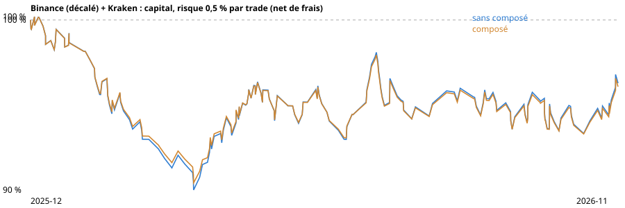
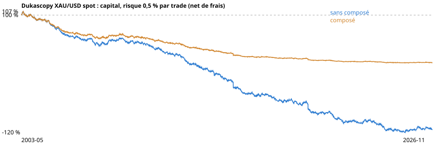
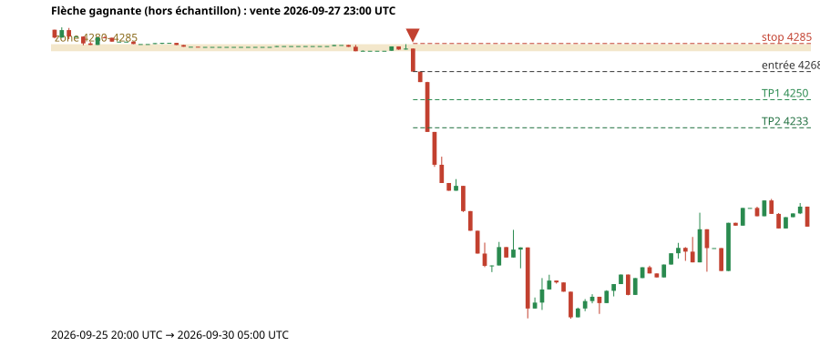
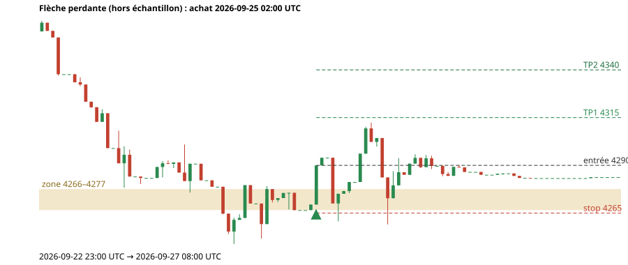
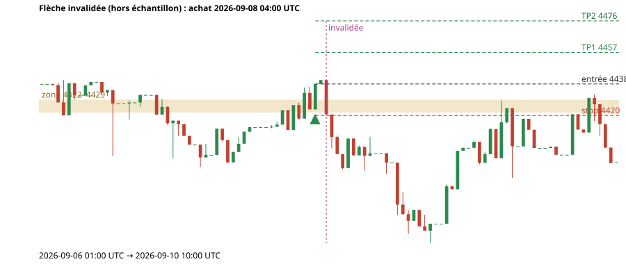

# RAPPORT : historique des flèches v8 « Direct » et bilan honnête (2026-11-13)
**Outil de mesure, jamais un conseil ni un ordre.** Les règles de la v8 ont été **figées avant tout calcul** : SHA-256 global `f4d95f60d2668d7aeba938570edf1048d7e705084d51dfc2c07871ebc89f547c` (31 fichiers de règles + paramètres, détail dans `recherche-or/historique-fleches-sceau.json`, vérifié identique au lancement de cette étude : oui). Aucune règle n'a été retouchée après avoir vu les résultats ; un mauvais résultat serait rapporté tel quel.

## 0. Méthode
- **Calcul causal** : rejeu bougie par bougie de `fleches-simples-v8` (à chaque pas le moteur ne voit que les bougies déjà closes), par morceaux de 800 bougies avec 640 bougies de recouvrement et 3000 de contexte (niveaux hebdomadaires, mensuels et zones recalculés de façon causale à partir des bougies). Vérifié **identique** au rejeu d'une seule passe (aucune flèche en plus ou en moins, mêmes drapeaux) : test `tests/fleches-historique-test.mjs`.
- **Données** : (A) référence **Binance XAUUSDT décalée de -4,88 $** avant la 1ʳᵉ bougie Kraken (2025-12-11 08:00 UTC → 2026-08-05 14:00 UTC, 5694 bougies), puis **Kraken PF_XAUUSD** (2404 bougies) : c'est la série du graphique. Écart médian mesuré Kraken − Binance sur les 2405 bougies communes : -4,56 $ (le décalage choisi est celui de l'appli : -4,88 $). (B) **Dukascopy XAU/USD spot (bid)** de 2003 à 2026-11-11 : instrument différent (spot, pas le perpétuel Kraken) mais 23 ans de hors échantillon. Les deux séries se recoupent en 2026 : ne pas les additionner.
- **Trade simulé** : entrée = clôture de confirmation ; stop = bord extérieur de la zone + 0,2 ATR ; TP1 à 1 R, TP2 à 2 R (moitié de la position à chaque cible, le stop ne bouge pas après TP1) ; sortie forcée après 48 bougies ; stop et cible dans la même bougie : le stop ; trou au-delà du stop : exécuté à l'ouverture. **Frais choisis** : spread 1 point de base + glissement 0.5 pb par aller-retour (= 0,60 $ à 4 000 $), retirés du résultat en R (frais ÷ risque). Flèches comptées : retournements et rebonds de base colorés (invalidées comprises : l'invalidation n'est pas connue à l'entrée) ; cassures MA200 (masquées par défaut) et flèches grises exclues.
- **Période de réglage** : à partir du **1ᵉʳ octobre 2026** (début de la période regardée pour régler les règles). Tout ce qui est avant est du test hors échantillon. **Les règles ont été réglées sur la période récente : le hors échantillon est la partie utile.**
- **Hasard** : 1000 tirages de N entrées aléatoires par ensemble (même sens, même nombre de trades, mêmes règles de sortie, stop de même taille en ATR tiré parmi ceux des vraies flèches, entrées tirées parmi les bougies ACTIVES seulement : une première version tirait aussi les bougies plates des week-ends (31 % des bougies Dukascopy, ATR proche de 0, frais énormes en R) et rendait le hasard artificiellement mauvais ; corrigé avant de conclure). « Place du réel » = part des tirages moins bons que le réel ; p = part des tirages au moins aussi bons. Pour « tous », la référence est le mélange achats + ventes dans les mêmes proportions et la p retenue est la plus prudente des deux sens. **Correction de Holm** sur les 6 variantes (avant / après × tous / achats / ventes) de chaque série. « Mieux que le hasard » seulement si n ≥ 30, p corrigée < 0.05 et R net moyen > 0 ; sinon « pas mieux que le hasard » ou « pas assez de données ».
- **Biais de marché** : l'or a monté fortement (2003-2011, 2019-2020, 2024-2026) puis a reculé (2011-2015, fin 2025 et 2026 selon la série) : un achat au hasard gagne donc plus qu'une vente au hasard sur ces périodes. C'est pourquoi les achats et les ventes sont comparés **chacun à ses propres tirages au hasard** et présentés séparément.

## 1. Série du graphique : Binance (décalé) puis Kraken
Série : 8098 bougies H1 closes du 2025-12-11 08:00 UTC au 2026-11-13 17:00 UTC.
**Flèches** : 277 calculées, dont 196 colorées (retournements et rebonds de base), 27 grises (contre-tendance), 54 cassures MA200 (masquées par défaut), 17 invalidées. **Trades simulés terminés** (colorées, invalidées comprises) : 195.

### Bilan (net = après frais ; « brut » = sans frais)
| Ensemble | n trades | Réussite brut / net | R moyen brut / net | Profit factor brut / net | R net du hasard (moy. [5 % ; 95 %]) | Place du réel | p | p (Holm) | Verdict |
|---|---|---|---|---|---|---|---|---|---|
| avant · tous | 165 | 38 % / 38 % | -0,01 / -0,05 | 0,98 / 0,90 | -0,01 [-0,20 ; 0,19] | 20 % | 0,800 | 1,000 | **pas mieux que le hasard** |
| avant · achats | 77 | 38 % / 38 % | -0,07 / -0,11 | 0,86 / 0,80 | -0,00 [-0,22 ; 0,21] | 22 % | 0,779 | 1,000 | **pas mieux que le hasard** |
| avant · ventes | 88 | 39 % / 39 % | 0,04 / -0,00 | 1,09 / 0,99 | -0,02 [-0,21 ; 0,18] | 56 % | 0,446 | 1,000 | **pas mieux que le hasard** |
| après · tous | 30 | 40 % / 40 % | 0,09 / 0,04 | 1,20 / 1,07 | -0,01 [-0,46 ; 0,44] | 20 % | 0,801 | 1,000 | **pas mieux que le hasard** |
| après · achats | 10 | — / — | — | — | — | — | — | — | **pas assez de données** |
| après · ventes | 20 | — / — | — | — | — | — | — | — | **pas assez de données** |
Plus longue série perdante (net, tous les trades) : **9** trades. Répartition des sorties : {"stop":93,"tp1-puis-stop":22,"tp2":55,"tp1-puis-temps":13,"temps":12}.

### Courbes de capital (0,5 % de risque par trade, net de frais)
| Ensemble | Fin, sans composé | Fin, composé | Drawdown max sans composé | Drawdown max composé |
|---|---|---|---|---|
| avant la période de réglage | 95,8 % | 95,6 % | 10,1 % | 9,7 % |
| après la période de réglage | 100,5 % | 100,5 % | 2,4 % | 2,4 % |
| toute la série | 96,3 % | 96,1 % | 10,1 % | 9,7 % |

### Nombre de flèches colorées par mois
| Mois | Flèches |
|---|---|
| 2025-12 | 5 |
| 2026-01 | 17 |
| 2026-02 | 22 |
| 2026-03 | 13 |
| 2026-04 | 25 |
| 2026-05 | 19 |
| 2026-06 | 16 |
| 2026-07 | 20 |
| 2026-08 | 10 |
| 2026-09 | 18 |
| 2026-10 | 20 |
| 2026-11 | 11 |

## 2. Série longue : Dukascopy XAU/USD spot 2003 → 2026
Série : 204825 bougies H1 closes du 2003-05-05 00:00 UTC au 2026-11-11 11:00 UTC.
**Flèches** : 5993 calculées, dont 3896 colorées (retournements et rebonds de base), 809 grises (contre-tendance), 1288 cassures MA200 (masquées par défaut), 349 invalidées. **Trades simulés terminés** (colorées, invalidées comprises) : 3896.

### Bilan (net = après frais ; « brut » = sans frais)
| Ensemble | n trades | Réussite brut / net | R moyen brut / net | Profit factor brut / net | R net du hasard (moy. [5 % ; 95 %]) | Place du réel | p | p (Holm) | Verdict |
|---|---|---|---|---|---|---|---|---|---|
| avant · tous | 3868 | 36 % / 36 % | -0,05 / -0,11 | 0,90 / 0,80 | -0,06 [-0,10 ; -0,02] | 0 % | 0,998 | 1,000 | **pas mieux que le hasard** |
| avant · achats | 1942 | 38 % / 38 % | -0,00 / -0,06 | 1,00 / 0,88 | -0,03 [-0,07 ; 0,01] | 12 % | 0,882 | 1,000 | **pas mieux que le hasard** |
| avant · ventes | 1926 | 33 % / 33 % | -0,10 / -0,16 | 0,82 / 0,73 | -0,09 [-0,12 ; -0,05] | 0 % | 1,000 | 1,000 | **pas mieux que le hasard** |
| après · tous | 28 | — / — | — | — | — | — | — | — | **pas assez de données** |
| après · achats | 16 | — / — | — | — | — | — | — | — | **pas assez de données** |
| après · ventes | 12 | — / — | — | — | — | — | — | — | **pas assez de données** |
Plus longue série perdante (net, tous les trades) : **15** trades. Répartition des sorties : {"tp1-puis-temps":190,"tp2":1071,"stop":1892,"tp1-puis-stop":437,"temps":306}.

### Courbes de capital (0,5 % de risque par trade, net de frais)
| Ensemble | Fin, sans composé | Fin, composé | Drawdown max sans composé | Drawdown max composé |
|---|---|---|---|---|
| avant la période de réglage | -112,5 % | 11,1 % | 213,0 % | 90,3 % |
| après la période de réglage | 97,7 % | 97,7 % | 3,9 % | 3,9 % |
| toute la série | -114,9 % | 10,9 % | 213,0 % | 90,3 % |

### Nombre de flèches colorées par mois
(283 mois : moyenne 13,8 par mois ; 24 derniers mois ci-dessous)
| Mois | Flèches |
|---|---|
| 2024-12 | 14 |
| 2025-01 | 12 |
| 2025-02 | 10 |
| 2025-03 | 8 |
| 2025-04 | 13 |
| 2025-05 | 17 |
| 2025-06 | 15 |
| 2025-07 | 11 |
| 2025-08 | 11 |
| 2025-09 | 8 |
| 2025-10 | 10 |
| 2025-11 | 13 |
| 2025-12 | 14 |
| 2026-01 | 14 |
| 2026-02 | 23 |
| 2026-03 | 12 |
| 2026-04 | 12 |
| 2026-05 | 14 |
| 2026-06 | 10 |
| 2026-07 | 22 |
| 2026-08 | 10 |
| 2026-09 | 21 |
| 2026-10 | 22 |
| 2026-11 | 6 |

### Par année (Dukascopy) : tendance du marché contre résultat par sens
| Année | Variation du prix | Trades | Achats | Ventes | R net moyen (tous) | R net achats | R net ventes |
|---|---|---|---|---|---|---|---|
| 2003 | 22,0 % | 115 | 50 | 65 | -0,04 | -0,15 | 0,05 |
| 2004 | 5,5 % | 142 | 75 | 67 | -0,20 | -0,18 | -0,22 |
| 2005 | 17,9 % | 128 | 68 | 60 | -0,34 | -0,28 | -0,41 |
| 2006 | 23,2 % | 148 | 85 | 63 | -0,10 | 0,01 | -0,26 |
| 2007 | 31,0 % | 163 | 81 | 82 | -0,08 | -0,05 | -0,11 |
| 2008 | 5,6 % | 181 | 97 | 84 | 0,11 | 0,17 | 0,03 |
| 2009 | 24,6 % | 162 | 76 | 86 | -0,09 | -0,10 | -0,07 |
| 2010 | 29,4 % | 154 | 85 | 69 | -0,20 | -0,14 | -0,27 |
| 2011 | 10,5 % | 163 | 81 | 82 | -0,10 | -0,05 | -0,16 |
| 2012 | 7,0 % | 169 | 87 | 82 | -0,22 | -0,17 | -0,28 |
| 2013 | -27,9 % | 187 | 110 | 77 | -0,09 | -0,14 | -0,02 |
| 2014 | -1,8 % | 185 | 89 | 96 | -0,20 | -0,10 | -0,30 |
| 2015 | -10,6 % | 168 | 63 | 105 | -0,31 | -0,18 | -0,39 |
| 2016 | 8,2 % | 173 | 88 | 85 | -0,07 | -0,01 | -0,14 |
| 2017 | 13,2 % | 173 | 86 | 87 | -0,11 | -0,01 | -0,21 |
| 2018 | -1,9 % | 163 | 80 | 83 | -0,01 | -0,07 | 0,05 |
| 2019 | 18,4 % | 165 | 99 | 66 | -0,24 | 0,01 | -0,63 |
| 2020 | 25,0 % | 169 | 84 | 85 | -0,00 | 0,14 | -0,14 |
| 2021 | -4,4 % | 158 | 78 | 80 | -0,24 | -0,12 | -0,35 |
| 2022 | -0,3 % | 168 | 91 | 77 | 0,05 | 0,05 | 0,05 |
| 2023 | 12,8 % | 171 | 80 | 91 | -0,13 | -0,25 | -0,02 |
| 2024 | 27,2 % | 183 | 87 | 96 | -0,11 | -0,03 | -0,18 |
| 2025 | 64,6 % | 142 | 63 | 79 | 0,08 | 0,14 | 0,03 |
| 2026 | -7,0 % | 166 | 75 | 91 | -0,04 | -0,19 | 0,09 |
(« — » : moins de 5 trades, aucun chiffre.)

## 3. Trois exemples réels hors échantillon (série du graphique, avant le 1ᵉʳ octobre 2026)
### Exemple gagnante
Vente confirmé le 2026-09-27 23:00 UTC sur niveau 4280–4285 · entrée 4267,58 · stop 4284,98 · TP1 4250,18 · TP2 4232,78 · sortie tp2 le 2026-09-28 01:00 UTC · **1,50 R brut, 1,46 R net**.

### Exemple perdante
Achat confirmé le 2026-09-25 02:00 UTC sur niveau 4266–4277 · entrée 4289,60 · stop 4264,52 · TP1 4314,68 · TP2 4339,76 · sortie stop le 2026-09-25 06:00 UTC · **-1,00 R brut, -1,03 R net**.

### Exemple invalidée
Achat confirmé le 2026-09-08 04:00 UTC sur Support 4 422–4 429 · 8 touches · ancienne résistance 4422–4429 · entrée 4438,41 · stop 4419,79 · TP1 4457,03 · TP2 4475,66 · sortie stop le 2026-09-08 07:00 UTC · **-1,00 R brut, -1,04 R net** · invalidée à 2026-09-08 06:00 UTC.

## 4. Retardement et flèches retirées par les règles (série du graphique)
- espace : 357
- contre : 52
- proche : 160
- tardif : 64
- chute : 45
- aller-retour : 29
- plafond : 1

## 5. Limites honnêtes
- Les règles v8 ont été choisies en regardant des exemples de la période récente : les résultats « après » ne sont pas un test. Les « avant » le sont, mais l'historique 2003-2025 est du **spot** Dukascopy (bid), pas le perpétuel Kraken ; les niveaux et la liquidité d'alors diffèrent.
- Les trades simulés supposent une exécution à la clôture de la bougie de confirmation, sans refus ni requote ; le glissement réel peut être pire, surtout lors des annonces.
- Les trades se chevauchent parfois ; la courbe de capital ajoute chaque trade à sa sortie sans tenir compte d'un plafond d'exposition.
- Deux variantes de sortie (TP1 seul, TP2 seul) n'ont **pas** été testées pour ne pas multiplier les comparaisons.
- n < 30 : aucun chiffre de performance n'est donné (« pas assez de données »).

## 6. Verdict
Hors échantillon (Dukascopy XAU/USD spot, 3868 trades), le résultat net de frais est de -0,11 R par trade et n'est pas mieux que le hasard après correction de Holm. Après la période de réglage (30 trades) le verdict est « pas mieux que le hasard », mais ces règles y ont été réglées : ce n'est pas un test. Verdict : non, aucun avantage démontré hors échantillon. Seul le registre en direct (flèches posées à partir du 13 novembre 2026, lignes jamais modifiées) permettra de trancher.
